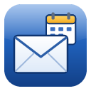

# ClassicMail

A desktop client for Google Workspace and Gmail in the classic Outlook style — Mail, Calendar,
Contacts, Tasks and the To-Do Bar, with Outlook-style Rules — for people who miss the Outlook they
knew. Windows; built with Tauri (Rust) and React.



By **Kenny Green**, © 2026 Duvz Software. Free and open source under the
[Apache License 2.0](LICENSE): use it, change it, share it, build on it — just keep the credit
(the [NOTICE](NOTICE) file goes with every copy and fork). Comments and ideas: info@duvz.com.

## Install

You need Windows 10 or 11 (64-bit). What changed in each version: [CHANGELOG.md](CHANGELOG.md).

1. **Get the installer.** Download `ClassicMail_<version>_x64-setup.exe` from the
   [Releases](https://github.com/kenrunio/classicmail/releases) page, or build it yourself (see
   **Development** below).
2. **Run it.** It needs no admin rights and installs for the current Windows user. The app isn't
   code-signed yet, so Windows SmartScreen may say "Windows protected your PC": click
   **More info → Run anyway**.
3. **Start ClassicMail.** On the welcome screen, either click **Use demo accounts** to look around
   (no Google account needed, nothing is sent anywhere), or connect your own Google account as in
   step 4.
4. **Connect Gmail or Google Workspace.** Google lets a desktop app reach your mail only through a
   sign-in "client" in a Google Cloud project. ClassicMail has no shared client and no server, so
   you create your own, once: it's free and takes about 15 minutes. Follow
   **[docs/google-setup.md](docs/google-setup.md)**, step by step; it works for company Google
   Workspace addresses and for ordinary @gmail.com addresses. Then, in ClassicMail, click
   **Import client file…**, pick the JSON file you downloaded, and **Sign in with Google…**.

Your mail then goes straight between Google and your PC. See [Privacy and security](#privacy-and-security).

## Using it

It works like Outlook 2007: Navigation Pane on the left (Mail / Calendar / Contacts / Tasks),
the To-Do Bar on the right, Reading Pane, double-click to open items in their own windows,
right-click menus everywhere, drag messages onto folders.

| Keys | Action |
|---|---|
| Ctrl+1 / 2 / 3 / 4 | Mail / Calendar / Contacts / Tasks |
| Ctrl+N | New item in the current module (in an item window: another of its kind) |
| Ctrl+Shift+M / A / Q / C / K | New message / appointment / meeting / contact / task, from any window |
| Ctrl+R, Ctrl+Shift+R, Ctrl+F | Reply, Reply to All, Forward |
| Ctrl+Enter or Alt+S | Send (in a message) |
| Ctrl+Q / Ctrl+U | Mark read / unread |
| Insert | Flag for follow-up |
| Ctrl+Shift+V | Move to folder |
| Ctrl+E or F3 | Instant Search |
| Ctrl+Shift+I / Ctrl+Shift+O | Go to Inbox / Outbox |
| Ctrl+Shift+E | New folder |
| F9 or Ctrl+M | Send/Receive now |
| Alt+F1 / Alt+F2 | Navigation Pane / To-Do Bar |
| Alt+letter or F10 | Open a menu; then the underlined letter, the arrow keys and Enter |
| Y / N / C, Enter, Esc | Answer a Yes / No / Cancel box; in any dialog, Enter is OK and Esc is Cancel |

Shortcuts work whatever keyboard language is on (Hebrew, for example).

- **Gmail labels are folders.** Moving a message changes its labels; nested labels (`Clients/Orion`)
  are subfolders. Flags are Gmail stars (the follow-up date is kept locally).
- **Names in From / To / Cc / Bcc** can be cut, copied and pasted, as in Outlook: click a name
  (Ctrl/Shift+click, drag or Shift+arrows for more, Ctrl+A for all of them), then Ctrl+X / C / V or
  right-click. They are copied as `Name <email>; …`, and pasting that into a To box gives the names.
  Drag names between To, Cc and Bcc to move them (Ctrl+drag copies), or from a message you read.
- **Attachment folders are learnt per company** (the other party's e-mail domain): Save As, Save All
  Attachments and Attach File › Browse open in the folder used before for that company — the usual
  one when it has over 75% of the saves (Tools › Options › Preferences), else the folder they share.
- **Paste or drop files to attach them:** copy files in Explorer (Ctrl+C), then Ctrl+V (or Paste)
  in a message, or drag them from Explorer / the desktop onto the message window, as in Outlook.
- **Tables, like Word** (Format Text › Table): insert, Shading, Borders (all / outside / inside /
  one side / none, in a pen colour and width), rows & columns, merge / split, header row, cell
  alignment, Even Out (columns after the first and rows after the header the same size); drag a
  column's or row's line to resize it. Works on tables in a forwarded / quoted e-mail too.
- **The Font group follows the cursor**, like Word: font, size and B / I / U / S of the text at the
  cursor or across the selection (blank when it is mixed); with Ctrl+A they change the whole message. Font, size and Format Painter also work in the quoted original.
- **Typing fixes in a message, like Word:** Caps Lock left on ("eLI" → "Eli", Caps Lock goes off);
  the Hebrew keyboard left on for an English word ("Eךן" → "Eli" when the word ends, the keyboard
  switches to English); an empty line runs right-to-left while a Hebrew keyboard is on.
- **AI Review** carries out `{instructions}` in curly braces, also ones typed into the original
  below the reply. Square brackets are ordinary text. It can look things up on this computer:
  free time in your calendar (`{a free slot Tuesday afternoon next week}`), your meetings and their
  details (Zoom links, addresses), tasks and due dates, and exact time-zone conversions. Only your
  primary calendar counts as busy unless you name another one; Tools › Options › Calendar sets the
  usual meeting length (45 min) and the gap kept between meetings (15 min).
- **Rules** (Tools › Rules and Alerts) run on this computer when new mail arrives, like Outlook's
  client-side rules. Tick *Also keep these rules in Gmail* and the ones Gmail can do (sender,
  recipients, subject words, attachments → move / copy / delete / mark read / star) are kept as
  Gmail filters too, so they work while ClassicMail is closed. That needs Gmail's "manage settings"
  permission: mailboxes signed in before 1.9 have to sign in once more.
- **First sync takes a while.** Google limits how fast an app may read a mailbox (since May 2026:
  6,000 units per user per minute), so the first download of a big mailbox runs in the background —
  roughly 45 min per 10,000 messages. Newest mail arrives first, new mail keeps arriving meanwhile,
  and Calendar/Contacts/Tasks sync in between. Details: [docs/google-api-notes.md](docs/google-api-notes.md).
- **Drag an attachment** onto an Explorer folder, the desktop or another program to save / use it there.
- **Attachments:** like Outlook, program-type attachments (.exe, .js, .lnk, …) can't be opened
  directly (use Save As); other non-document types ask before opening. Saved files are marked as
  downloaded from the internet, so Office opens them in Protected View.
- **Offline:** everything you've synced is on this computer; changes you make offline are sent
  the next time you're connected.
- Settings: Tools › Options. Accounts: Tools › Account Settings.

## Privacy and security

- **No ClassicMail server.** The app talks only to Google, through your own Google Cloud project.
  Nobody else, the author included, can see your mail.
- **Your sign-in** (Google's refresh token) is kept in Windows Credential Manager (entry
  `ClassicMail`), never in a file. The Google client JSON you import is kept in the app's database;
  keep the downloaded file private and don't commit it to a repository (`google-client.json` and
  `client_secret*.json` are in `.gitignore`).
- **Your data** (the synced mail, calendar, contacts and tasks, and the logs) lives in
  `%APPDATA%\com.ekgir.classicmail` on your PC. Logs hold no message content.
- **AI features** (Translate, Reply with AI, AI Review) use **your own** Gemini or Claude API key
  and send the text they work on straight to that provider, only when you use one and after a
  one-time notice. Tools › Options › AI turns them off.
- **Removing an account** (Tools › Account Settings › Remove) deletes its local data and signs it
  out of Google. You can also cut off access at any time at
  <https://myaccount.google.com/permissions>.
- Full details: [docs/privacy-policy.md](docs/privacy-policy.md). To report a security problem, see
  [SECURITY.md](SECURITY.md).

## Development

Requirements: Node 20+, Rust (rustup), Visual Studio Build Tools with the Windows SDK. To sign
in to Google you need your own OAuth client (see [docs/google-setup.md](docs/google-setup.md));
without one, the demo accounts work.

```bash
npm ci
npm run dev:app          # run the app (demo data via the built-in fake Google server)
npm run release          # build the installer into release/
cd src-tauri && cargo test
npx tsc --noEmit
```

- Rust build output goes to `C:\dev\outlook_build\target` by default (set in
  `src-tauri/.cargo/config.toml`), so a checkout inside a synced folder such as Google Drive or
  OneDrive doesn't sync gigabytes of build files. To build somewhere else, set the
  `CARGO_TARGET_DIR` environment variable (Cargo prefers it over the config file), e.g.
  `set CARGO_TARGET_DIR=%CD%\src-tauri\target`; `npm run release` and `scripts/dev.mjs` follow it
  too.
- **Your own Google client built in:** copy your client JSON into the project folder as
  `google-client.json` before `npm run release`, and the installer signs in without importing the
  file on each PC. Keep that installer to yourself: anyone using it signs in through your Google
  project. Build without the file for an installer you can share (people then import their own
  client). The file is in `.gitignore`; never commit it.
- `docs/design.md` is the architecture; `docs/contracts.md` the cross-module APIs.
- `scripts/dev.mjs --slot N` runs isolated instances; `scripts/cdp.mjs` drives the running app over
  the WebView2 DevTools protocol for end-to-end checks and screenshots.

## Licence and credit

Copyright 2026 Duvz Software, written by Kenny Green. Licensed under the Apache License, Version
2.0 ([LICENSE](LICENSE)). You may use, modify and redistribute ClassicMail, including in your own
products, as long as you keep the copyright notices and the [NOTICE](NOTICE) file that credits the
original author, and mark the files you changed.
